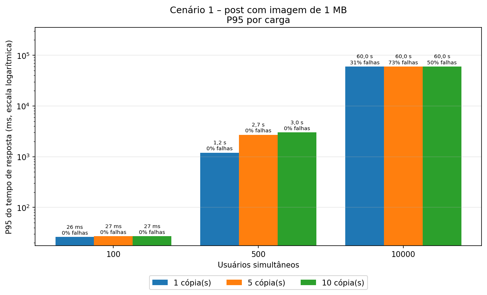
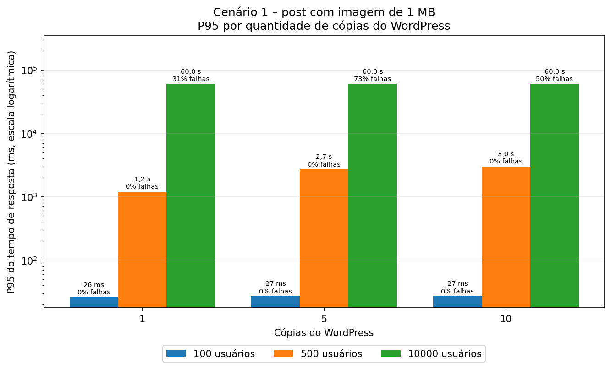
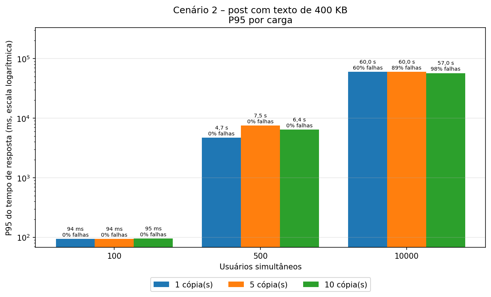
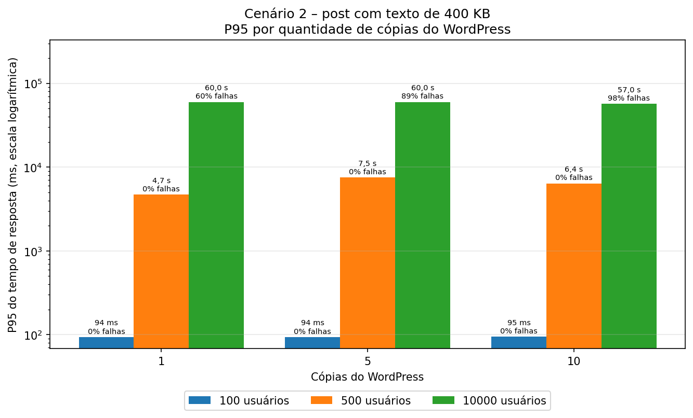
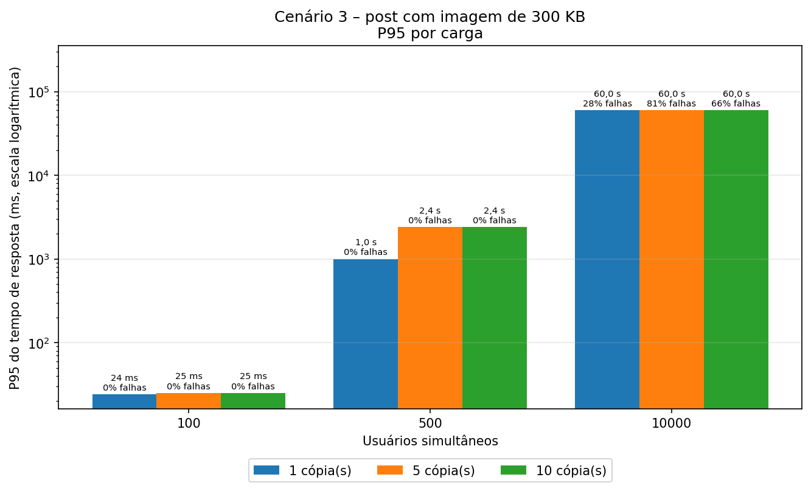
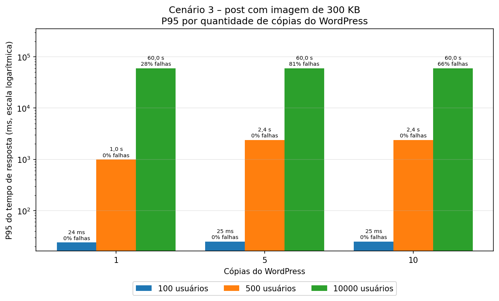

# Trabalho 3 – Testes de Carga com Múltiplas Instâncias do WordPress usando o Locust

## 1. Objetivo

Medir o desempenho do WordPress do Trabalho 2 (versão escalável) com o **Locust**, variando:

- a **quantidade de cópias do WordPress**: 1, 5 e 10;
- a **quantidade de usuários simultâneos**: 100 (baixa carga), 500 (média) e 10000 (alta);
- o **cenário**, que é o post acessado:
  1. post com uma imagem de ~1 MB;
  2. post com um texto de ~400 KB;
  3. post com uma imagem de ~300 KB.

São 3 × 3 × 3 = **27 rodadas**. A métrica dos gráficos é o **P95 do tempo de resposta**: 95% das requisições responderam em até esse tempo.

Os testes foram rodados nas máquinas de dois integrantes, e cada um grava numa pasta própria (seção 6).

## 2. Arquitetura

```
                                        ┌──────────────┐
                                   ┌───▶│ wordpress #1 │───┐
┌──────────────────┐               │    └──────────────┘   │
│ locust           │    ┌───────┐  │    ┌──────────────┐   │    ┌───────┐
│ 1 master         │───▶│ nginx │──┼───▶│ wordpress #2 │───┼───▶│ mysql │
│ + 4 workers      │    └───────┘  │    └──────────────┘   │    └───────┘
└──────────────────┘ http://nginx  │          ...          │
                                   │    ┌──────────────┐   │
                                   └───▶│ wordpress #N │───┘
                                        └──────────────┘
```

| Serviço     | Imagem                                         | Função                                                   |
|-------------|------------------------------------------------|----------------------------------------------------------|
| `nginx`     | `nginx:1.19.0`                                 | Balanceador de carga (porta 80)                          |
| `wordpress` | `wordpress:5.4.2-php7.2-apache`                | N cópias, escolhidas com `./escalar.sh N`                |
| `db`        | `mysql:5.7`                                    | Banco compartilhado por todas as cópias                  |
| `locust`    | `grubykarol/locust:1.2.3-python3.9-alpine3.12` | Gerador de carga (interface web na porta 8089)           |

O Locust fica no mesmo `docker-compose.yml` e acessa o site pelo nome do serviço, `http://nginx`, como o enunciado pede.

## 3. Estrutura de arquivos

```
trabalho-3/
├── docker-compose.yml        <- os 4 serviços
├── nginx.conf                <- balanceador (pool "wordpress:80" = todas as cópias)
├── apache-mpm-prefork.conf   <- limite de processos do Apache por cópia
├── escalar.sh                <- muda a quantidade de cópias e recarrega o Nginx
├── rodar_testes.sh           <- roda as 27 rodadas de uma vez
├── gerar_graficos.py         <- gera os gráficos de P95 a partir dos CSVs
├── conteudo/                 <- imagem de 1 MB, texto de 400 KB e imagem de 300 KB
├── locust/
│   ├── cenario1_imagem_1mb.py
│   ├── cenario2_texto_400kb.py
│   ├── cenario3_imagem_300kb.py
│   ├── comum.py              <- descobre o caminho das imagens no post
│   ├── distribuido.sh        <- sobe o Locust com 1 master e 4 workers
│   └── teste_conexao.py      <- teste mínimo (GET /)
├── resultados/
│   ├── resultados-matheus-d/ <- resultados da máquina do Matheus D.
│   │   └── graficos/
│   └── resultados-matheus-h/ <- resultados da máquina do Matheus H. (depois de rodar)
│       └── graficos/
└── wordpress/                <- criada ao subir os contêineres (fora do git)
```

## 4. Como funcionam os testes

Cada usuário do Locust repete o mesmo ciclo: abre o post, baixa a imagem (cenários 1 e 3) e espera de 1 a 2 s. O Locust não baixa sozinho as imagens de uma página, por isso o GET da imagem fica explícito no script.

Os posts são acessados pelo **slug** (`/?name=cenario-1-imagem-1-mb`) e não pelo ID (`/?p=6`). O ID muda de uma instalação para outra, e o slug só depende do título. O caminho da imagem (`/wp-content/uploads/<ano>/<mês>/...`) depende do mês em que ela foi enviada, então o `locust/comum.py` o procura no HTML do post quando o teste começa.

Para cada quantidade de cópias, o `rodar_testes.sh`:

1. sobe as cópias com o `escalar.sh` e confere, pelo cabeçalho `X-Upstream`, que o Nginx distribui entre todas elas;
2. roda os 3 cenários com 100, 500 e 10000 usuários, 4 minutos cada, com 60 s de pausa entre as rodadas;
3. só começa a contar depois que todos os usuários entram (`--reset-stats`) e grava os CSVs do Locust.

Falhas nas requisições **não** param o script, porque elas fazem parte do resultado. Se o script for interrompido, basta rodar de novo: as rodadas que já têm CSV são puladas.

### Ajustes feitos para o teste medir o servidor

Durante os testes apareceram gargalos que não eram do WordPress. Cada ajuste abaixo veio de um problema observado:

| Ajuste | Problema que resolveu |
|---|---|
| **Nginx** (`nginx.conf`): `worker_processes auto`, `worker_connections 16384`, `worker_rlimit_nofile 65535` | A configuração do Trabalho 2 (1 processo, 1024 conexões) dava erro 500 "Too many open files" com ~1000 usuários, qualquer que fosse o número de cópias |
| **MySQL**: `--max-connections=2000` | O padrão é 151 conexões. Com 5 e 10 cópias o banco recusava conexões, e havia erros mesmo na baixa carga |
| **Apache**: até 40 processos por cópia (padrão 150), em `APACHE_MAX_WORKERS` | Cada processo ocupa ~12 MB sob carga. Com 10 × 150 processos a memória acabava, e o sistema chegou a fechar o terminal e o VS Code. Com 40, 1 cópia mantém a mesma capacidade |
| **Locust**: `FastHttpUser` em vez de `HttpUser` | Com `HttpUser`, o próprio Locust passava de 90% de CPU com 250 usuários |
| **Locust**: 1 master + 4 workers (`locust/distribuido.sh`) e `cpu_shares` alto | Um processo do Locust usa só 1 núcleo e, com 10 cópias, não conseguia subir os usuários pedidos |
| **Locust**: limite de 65535 arquivos abertos | Com o limite padrão de 1024, o Locust falhava sozinho acima de ~1000 usuários |

### Por que 100, 500 e 10000 usuários

As quantidades foram escolhidas numa exploração com 50 a 20000 usuários, seguindo o que o professor pediu:

- **Baixa e média carga sem erros e com tempos bem diferentes:** 100 e 500 deram 0% de falhas em todas as rodadas, e o P95 da média é de 40 a 110 vezes o da baixa. Com 1000 usuários já apareciam falhas no cenário 2.
- **Alta carga com muitos erros:** 10000 foi a maior carga que o Locust conseguiu gerar na mesma máquina. Com 20000, o próprio Locust começava a falhar, por falta de CPU e de portas de rede.

## 5. Como rodar

### Requisitos

- Linux com Docker e Docker Compose v2 (`docker compose`);
- portas 80 e 8089 livres;
- Python 3 com matplotlib, para os gráficos: `sudo apt install python3-matplotlib` ou `pip install matplotlib`;

### Passo 1 – Subir o ambiente e instalar o WordPress

```bash
git clone https://github.com/MatheuzinDev/Trabalho-3-Computacao-Distribuida.git
cd Trabalho-3-Computacao-Distribuida
./escalar.sh 1
```

Abra http://localhost e faça a instalação do WordPress (idioma, título do site e usuário administrador).

### Passo 2 – Criar os 3 posts

No painel (http://localhost/wp-admin), crie e **publique** os posts com estes títulos exatos:

| Título | Conteúdo |
|---|---|
| `Cenário 1 – Imagem 1 MB` | Bloco de imagem com `conteudo/cenario1_imagem_1mb.jpg` |
| `Cenário 2 – Texto 400 KB` | Todo o texto de `conteudo/cenario2_texto_400kb.txt` colado no editor |
| `Cenário 3 – Imagem 300 KB` | Bloco de imagem com `conteudo/cenario3_imagem_300kb.jpg` |

Nas imagens, escolha o tamanho **"Tamanho completo"** no bloco, para o post usar o arquivo original e não uma versão reduzida.

Confira os slugs, que precisam ser exatamente estes. Os três comandos devem mostrar `200`:

```bash
for s in cenario-1-imagem-1-mb cenario-2-texto-400-kb cenario-3-imagem-300-kb; do
  curl -sL -o /dev/null -w "%{http_code} $s\n" "http://localhost/?name=$s"
done
```

Se algum der `404`, ajuste o slug do post no editor (campo "Link permanente" ou "URL") para o valor acima.

### Passo 3 – Rodar os testes na pasta da sua máquina

```bash
RESULTADOS=resultados-<seu-nome> ./rodar_testes.sh
python3 gerar_graficos.py resultados-<seu-nome>
```

A matriz completa leva **cerca de 2h25**. Não precisa subir as cópias antes, porque o script faz isso.

## 6. Pasta de resultados de cada máquina

Cada integrante grava os resultados numa pasta própria **dentro de `resultados/`**, escolhida pela variável `RESULTADOS`. O nome segue o padrão `resultados-<nome>-<inicial do sobrenome>`:

| Integrante | Comando | Pasta criada |
|---|---|---|
| Matheus D. | `RESULTADOS=resultados-matheus-d ./rodar_testes.sh` | `resultados/resultados-matheus-d/` |
| Matheus H. | `RESULTADOS=resultados-matheus-h ./rodar_testes.sh` | `resultados/resultados-matheus-h/` |

- **A pasta é criada sozinha.** O script cria `resultados/resultados-<nome>/` e a subpasta `logs/`. O `docker-compose.yml` monta `resultados/` dentro do contêiner do Locust como `/resultados`, e o Locust grava os CSVs em `/resultados/resultados-<nome>/`.
- **Gráficos:** `python3 gerar_graficos.py resultados-<nome>` grava 6 PNGs em `resultados/resultados-<nome>/graficos/`.

### Variáveis do `rodar_testes.sh`

| Variável | Padrão | O que faz |
|---|---|---|
| `RESULTADOS` | `resultados-teste` | Pasta desta máquina dentro de `resultados/` |
| `INSTANCIAS` | `"1 5 10"` | Quantidades de cópias do WordPress |
| `USUARIOS` | `"100 500 10000"` | Quantidades de usuários |
| `CENARIOS` | `"1 2 3"` | Cenários |
| `DURACAO` | `4m` | Duração de cada rodada |
| `PAUSA` | `60` | Segundos de pausa entre rodadas |
| `PASTA` | (vazia) | Subpasta dentro de `RESULTADOS`, por exemplo para uma exploração |

`WORKERS` (processos do Locust, padrão 4) e `APACHE_MAX_WORKERS` (processos do Apache por cópia, padrão 40) ficam no `docker-compose.yml`.

## 7. Resultados na máquina do Matheus Diógenes

Intel Core i7-1165G7 (4 núcleos / 8 threads), 15 GB de RAM, Ubuntu 24.04, Docker 29.8.1. O WordPress, o MySQL, o Nginx e o Locust rodam todos nessa mesma máquina.

**P95 do tempo de resposta (% de falhas)**

| Cenário | Cópias | 100 usuários | 500 usuários | 10000 usuários |
|---|---|---|---|---|
| 1 – imagem 1 MB | 1 | 26 ms (0%) | 1,2 s (0%) | 60,0 s (31%) |
| | 5 | 27 ms (0%) | 2,7 s (0%) | 60,0 s (73%) |
| | 10 | 27 ms (0%) | 3,0 s (0%) | 60,0 s (50%) |
| 2 – texto 400 KB | 1 | 94 ms (0%) | 4,7 s (0%) | 60,0 s (60%) |
| | 5 | 94 ms (0%) | 7,5 s (0%) | 60,0 s (89%) |
| | 10 | 95 ms (0%) | 6,4 s (0%) | 57,0 s (98%) |
| 3 – imagem 300 KB | 1 | 24 ms (0%) | 1,0 s (0%) | 60,0 s (28%) |
| | 5 | 25 ms (0%) | 2,4 s (0%) | 60,0 s (81%) |
| | 10 | 25 ms (0%) | 2,4 s (0%) | 60,0 s (66%) |

Na alta carga, o P95 fica em 60 s porque esse é o tempo máximo de espera: as requisições mais lentas caem em timeout.

| | P95 por carga | P95 por quantidade de cópias |
|---|---|---|
| Cenário 1 |  |  |
| Cenário 2 |  |  |
| Cenário 3 |  |  |

### Análise

- **Baixa carga (100):** tudo responde rápido, em 24 a 95 ms, com qualquer quantidade de cópias. O cenário 2 é o mais lento, porque o PHP monta a cada acesso uma página de 445 KB.
- **Média carga (500):** ainda sem erros, mas o P95 sobe para 1 a 7,5 s. O servidor já está saturado e as requisições esperam na fila.
- **Alta carga (10000):** de 28% a 98% de falhas.
  - Com 1 cópia, as falhas são timeouts e erros 504: as requisições esperam mais de 60 s.
  - Com 5 e 10 cópias, a maioria é erro 502: as filas das cópias enchem, e o Nginx recebe recusa na hora.

### Limitações

- O Locust roda na mesma máquina que o servidor e usa CPU que poderia ir para o WordPress. O ideal seria gerar a carga de outro computador.
- Não foi possível chegar a 100% de erros na alta carga: acima de 10000 usuários, o próprio Locust começava a falhar.

## 8. Resultados – máquina do Matheus H.

> A preencher depois de rodar `RESULTADOS=resultados-matheus-h ./rodar_testes.sh` e `python3 gerar_graficos.py resultados-matheus-h`.
